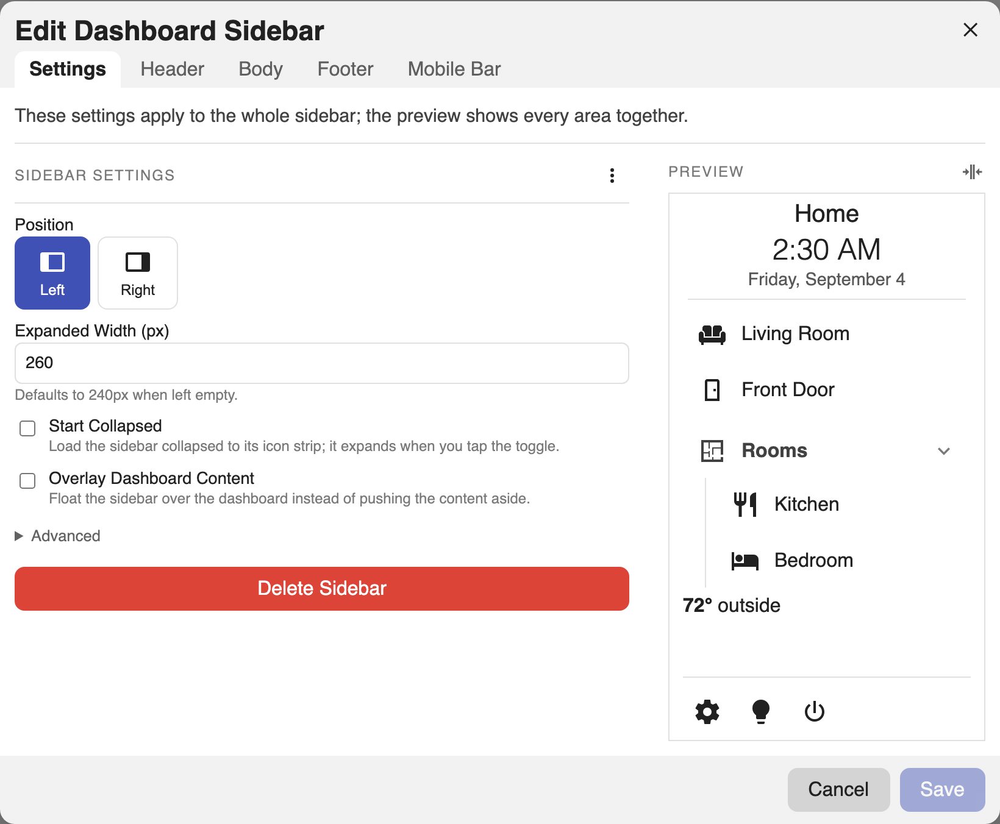
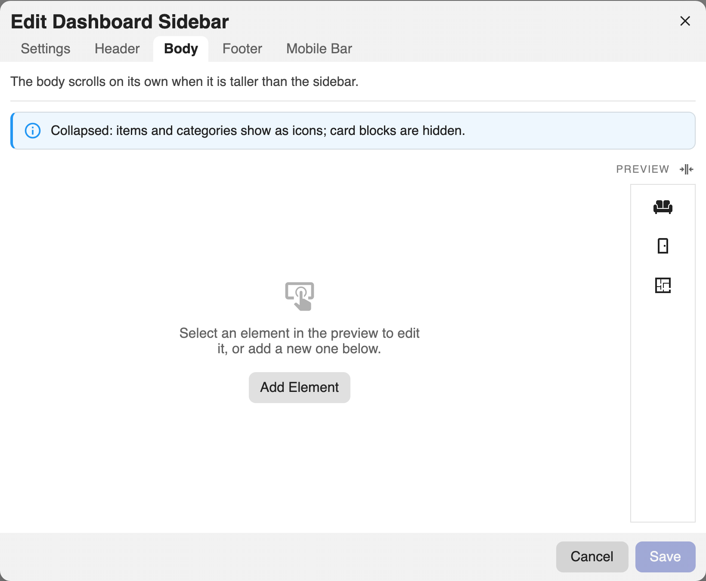

# Sidebar Settings

Sidebar-wide options live on the top level of the `dashboard_sidebar` config, and
in the editor's **Settings** tab.

!!! tip "Two ways to edit, one switch"
    Every how-to on this site has a **Visual editor** tab and a **YAML** tab
    showing the same change two ways. Pick one and the whole site follows you,
    on every page, until you switch back.

For the complete list of every field, its type, and whether it is required, see
the [Config Reference](reference.md) (generated from the source, always current).

## Sidebar-wide options

=== "Visual editor"

    Open the editor and go to the **Settings** tab. The main options are laid out
    as fields:

    - **Position**: which edge the sidebar docks to (left or right).
    - **Width**: the expanded width in pixels. Defaults to 240 when left empty.
    - **Start Collapsed**: load collapsed to the icon strip.
    - **Overlay Dashboard Content**: float the sidebar over the dashboard
      instead of pushing the content aside.
    - **Animate**: slide when collapsing and expanding. On by default; turn it
      off for kiosks and slow tablets.

    Under **Settings → Advanced**:

    - **Mobile Breakpoint (px)**: the viewport width at and below which the
      mobile choices apply. Defaults to 768.
    - **On Desktop**: whether the sidebar shows on wide screens, or nothing does.
    - **On Mobile**: whether narrow screens get the sidebar, the
      [mobile bar](mobile.md), or nothing.
    - **Visibility**: show the sidebar only to some users, on some screen sizes,
      or while an entity is in some state (see [Who sees it](#who-sees-it)).
    - **Background**: any CSS background, including gradients.
    - The whole-sidebar [Styles](styling.md#uix-and-card-mod) (UIX or card-mod).

    

=== "YAML"

    ```yaml
    dashboard_sidebar:
      position: right
      width: 300
      start_collapsed: false
      overlay: false
      animate: true
      on_desktop: sidebar
      on_mobile: bar
      breakpoint: 768
      background: linear-gradient(180deg, #1b2735, #090a0f)
      header: []
      body: []
      footer: {}
    ```

| Option | Type | Default | Description |
| --- | --- | --- | --- |
| `position` | `left` \| `right` | `left` | Which edge the sidebar docks to. |
| `width` | number (px) | `240` | Expanded width. |
| `start_collapsed` | boolean | `false` | Load collapsed to the icon strip. |
| `overlay` | boolean | `false` | Float over the dashboard instead of pushing the content aside. |
| `animate` | boolean | `true` | Slide when collapsing and expanding. See [Animation](#animation). |
| `visibility` | list | - | Show only when these conditions hold. See [Who sees it](#who-sees-it). |
| `on_desktop` | `sidebar` \| `hidden` | `sidebar` | What renders on wide (desktop) viewports. |
| `on_mobile` | `sidebar` \| `bar` \| `hidden` | `sidebar` | What renders on narrow (mobile) viewports. Defaults to `bar` when a `mobile` section exists. |
| `breakpoint` | number (px) | `768` | Viewport width at and below which "mobile" applies. |
| `background` | CSS `background` | theme card bg | Any CSS background, including gradients. |
| `header` | list | - | Blocks pinned to the top. |
| `body` | list | - | Blocks in the scrolling region. |
| `footer` | mapping | - | The bottom bar (see [Footer](footer.md)). |
| `uix` | mapping | - | Styles for the whole sidebar, applied by UIX (or card-mod) (see [Styling](styling.md#uix-and-card-mod)). |
| `card_mod` | mapping | - | The same as `uix` under card-mod's key; still works, will be deprecated. |

## Push or overlay

By default the sidebar **pushes**: the dashboard view sits beside it and narrows
by the sidebar's width, so nothing is ever covered. Set `overlay: true` and the
sidebar **floats** over the view instead, which keeps the dashboard at full
width at the cost of hiding whatever is underneath the sidebar. Collapsing works
the same either way, so an overlay sidebar that starts collapsed covers only the
icon strip until you expand it.

```yaml
dashboard_sidebar:
  overlay: true
  start_collapsed: true
```

An overlay sidebar draws a drop shadow so its edge reads against the content.
Restyle or remove it with `--dashboard-sidebar-overlay-shadow` (see
[Styling](styling.md#theme-variables)).

## Collapsing

The sidebar can collapse to a slim **icon strip** using the toggle on its edge;
the choice is remembered per browser. While collapsed:

- **Titles** and **Text** blocks are hidden.
- **Items** and **categories** show as icons (or their
  [abbreviation](elements.md#item) when they have no icon); hovering shows a
  tooltip, and a category opens a popover of its items.
- **Footer buttons** collapse into a single **⋯** menu.

The editor's **Preview** has its own collapse toggle so you can check the icon
strip while building:



## Animation

Collapsing and expanding slide the sidebar, and in push mode the dashboard
narrows or widens beside it. The sidebar always appears in its starting state
when a page loads, collapsed or not, without sliding into it.

Set `animate: false` (or turn off **Animate** in Settings) to drop every
sidebar animation: the slide, the chevron, and the mobile bar's menu. This
helps kiosk browsers and slow tablets, where an animation can stutter or
stall. The system's reduce-motion setting turns the animations off too.

```yaml
dashboard_sidebar:
  animate: false
```

## Who sees it

`visibility` shows the sidebar only when **every** condition in the list holds.
It uses the same conditions as a card's **Visibility** tab in Home Assistant,
so the YAML is interchangeable:

| Condition | Shows when |
| --- | --- |
| `user` | the signed-in user is one of `users` (user ids, from Settings › People › Users) |
| `screen` | the `media_query` matches, e.g. `(min-width: 1024px)` |
| `state` | `entity` is in `state` (one or a list), and not in `state_not` |
| `numeric_state` | `entity` is above `above` and/or below `below` |
| `and` / `or` / `not` | all / any / none of its `conditions` hold |

When the conditions don't hold, the sidebar (and its [mobile bar](mobile.md))
is left out entirely and the dashboard takes the full width. Screen and state
conditions are followed live, as the window resizes or the entity changes.
While the dashboard is being **edited**, the sidebar always shows, so one hidden
from you can still be changed.

=== "Visual editor"

    Under **Settings → Advanced → Visibility**, add conditions the same way as on
    a card's Visibility tab.

=== "YAML"

    ```yaml
    dashboard_sidebar:
      visibility:
        # only for these users, and only on wide screens
        - condition: user
          users:
            - 8b1f4c9e2d7a4e6f9c3b5a1d0e2f4a6b
        - condition: screen
          media_query: '(min-width: 1024px)'
    ```

User ids rather than names keep working when someone is renamed. In the visual
editor you pick users by name and it stores the ids for you. For YAML, the id is
shown when you open the user under **Settings › People › Users** (with advanced
mode on in your profile).

## Regions

- **Header**: pinned to the top, never scrolls.
- **Body**: scrolls on its own when taller than the sidebar.
- **Footer**: pinned to the bottom, never scrolls.

Each region holds an ordered list of [elements](elements.md).

=== "Visual editor"

    The **Header**, **Body**, and **Footer** tabs each edit the config key they
    are named for. Add an element with the **+** button, drag to reorder, and
    select any element to edit it.

=== "YAML"

    ```yaml
    dashboard_sidebar:
      header:
        - type: title
          text: Home
      body:
        - type: item
          title: Living Room
          tap_action: { action: navigate, navigation_path: /lovelace/living }
      footer:
        buttons:
          - icon: mdi:cog
            tap_action: { action: navigate, navigation_path: /config }
    ```
